# rent-database

Reads apartment and build-for-rent leasing pages into dated floor-plan rent records, with asking rent, net-effective rent after concessions, and availability, then rolls them up into the aggregate file the public rent page is built from.

**Live:** [www.hermanchan.ai/rent-database/](https://www.hermanchan.ai/rent-database/)

## Why it exists

A rent comp is only as good as the rent behind it. Listing sites show an asking rent, but the number that matters to an underwrite is what a renter actually pays after "6 weeks free" or "up to two months free", per floor plan, on the date it was offered. That detail lives on each community's own leasing page, spread across a dozen leasing platforms that each publish it differently.

## Architecture

```mermaid
flowchart LR
    U[Community URL] --> OP{Operator URL?}
    OP -- yes --> OA[Operator adapter]
    OP -- no --> H[One homepage fetch]
    H --> VD[Vendor detection<br/>every matching adapter,<br/>in priority order]
    VD --> VA[Vendor adapters]
    VA -- "error, or a plan catalog<br/>with no price or listing" --> PR[Subpath probe<br/>second look]
    PR -- nothing usable --> RR[Rendered-page readers<br/>JSON-LD, embedded payloads]
    RR -- nothing usable --> LLM[LLM tier<br/>injected provider]
    OA --> FIN
    VA --> FIN
    PR --> FIN
    RR --> FIN
    LLM --> BS[Backstops re-read the page<br/>base vs all-in, floor prices,<br/>concession scanner]
    BS --> FIN[Finalize<br/>concession sweep, sentinel and<br/>implausible-rent guards, ledger status]
    FIN --> SNAP[(Snapshot<br/>one per community per read)]
    SNAP --> NORM[Normalise<br/>dated records, net-effective rent,<br/>market rent]
    NORM --> BUILD[Rollup builder]
    BUILD --> JSON[rent-database.json]
```



| Module | What it does |
|---|---|
| `rentdb/adapters/` | 18 platform and operator adapters plus 2 rendered-page readers, the shared `UnitGroup` / `ExtractResult` types and their guards (`base.py`), detection and dispatch (`__init__.py`), the subpath probe (`probe.py`) |
| `rentdb/concessions.py` | Turns banner text into free weeks, and refuses what is not a community-wide rent concession (bed-scoped offers, dollars off, fee waivers, a non-rent product's promo) |
| `rentdb/llm_fallback.py` | The model prompt, defensive JSON parsing, and the deterministic backstops that re-check the model against the page |
| `rentdb/pipeline.py` | The read chain for one community, and `finalize`, which every tier goes through |
| `rentdb/normalize.py` | Snapshot to dated `RentRecord`s with net-effective and market rent |
| `rentdb/snapshot.py` | The rollup builder (CLI: `python -m rentdb.snapshot`) |
| `rentdb/replay.py` | Serves saved pages in place of the network, for the tests and the demo |
| `rentdb/demo.py` | Offline end to end: saved pages, read chain, snapshots, rollup |

## Quickstart

Runs offline on the bundled sample: saved pages from 10 communities, including 3 that go through the LLM tier with the model's saved reply replayed.

```sh
python3 -m venv .venv && . .venv/bin/activate && pip install -r requirements-dev.txt
python -m rentdb.demo          # writes out/communities.json, out/snapshots.jsonl, out/rent-database.json
pytest
```

The demo prints one line per community: the reader that priced it, the ledger status, the number of floor plans, the concession in weeks, and the lowest net-effective rent.

## How it's tested

- 249 tests, all offline. `pytest` runs with sockets disabled (`pytest-socket`), and `rentdb.replay` answers HTTP 404 for any URL that was not saved, so a test cannot reach the network by accident.
- Adapter tests run the real read chain over saved operator pages. Each page was trimmed to the elements the read uses, and a trim was kept only if the read stayed byte-for-byte identical. Expected values come from what the page showed when it was saved, not from the adapter's output.
- The LLM tier is tested against saved model replies. On two of the three saved pages the model put the fee-inclusive price in the base-rent field; the tests assert the backstop moves it back, using figures printed on the page.
- The concession scanner is tested on a table of banner wordings, including the ones it must refuse (dollars off, bed-scoped offers, fee waivers).
- The rollup builder is tested on a small hand-built dataset whose every number is worked out in the test, then checked for the same shape as the published file in `sample/rent-database.json`.
- CI runs ruff and the suite on Python 3.11 and 3.12.

## Design decisions

- **Adapters first, the model last, and a catalog does not end the search.** A platform feed that lists floor plans but no price or listed unit is treated as "keep looking", not as an answer, so a later adapter or the LLM still gets the page. The cost is extra fetches on some communities; the alternative was reporting a property as having nothing available while its own page showed priced units.
- **Observed values only, and null is a real answer.** Per-unit rents, bath counts, structure type and plan names are stored only when the page states them. `unit_rents = None` means the page published a range; a list means real observations. Market rent is the mean of the lowest five observations, or the low end of the range when there are none, so a reconstructed list would silently turn a range into a fake average.
- **The page is re-read instead of trusting the model.** After the LLM answers, regex backstops check base vs all-in rent, floor ("starting at") prices, square-footage bands and the concession count against the page text, and the scanner overrules the model's week count when they disagree. That is more code to maintain than a better prompt, but the same prompt-level rule kept being dropped.
- **Net-effective rent uses weeks only.** `ner = rent × (1 − weeks/52)`. A "$500 off" or "$2,000 off" offer is kept as text but never converted to weeks, because the conversion depends on lease terms the page does not give. This undercounts some concessions rather than inventing them.
- **The public output is aggregates plus a bounded sample.** Per-community rows are limited to a small, stratified sample, and a unit count appears only from a public record with its source named.

## What's not in this repo and why

- **The production database.** Snapshots lived in Postgres behind views that apply freshness, dead-URL and "sold out" carry-forward rules. `rentdb/snapshot.py` computes the same rollups in Python over a JSONL file; its docstring lists the view rules it simplifies.
- **The community registry.** The list of communities the scraper visits was seeded from licensed third-party market data. That list, its unit counts and its ownership and management fields are not published. The demo registry in `out/communities.json` is built from the saved pages and carries no unit counts.
- **Vendor-derived numbers in the published sample.** `sample/rent-database.json` is the file behind the live page (export of 2026-10-21) with two changes: 91 sample rows lose their build year, because it came from the vendor-seeded community registry rather than a public record, and 5 sample rows are left out because their names matched this repo's scrub list. Neither file carries a unit total: the only community-level unit count that covers every community is the vendor-seeded one.
- **The headless-browser fetcher and the hosted model client.** Production rendered JavaScript-only pages in a browser and sent the LLM tier through a spend-tracking client with batch submission. Here both are injected: `read_community(render=..., llm=...)`.
- **Scheduling, rotation and data-quality monitoring**, which depend on the production database.

---

© 2026 Herman Chan. Published for portfolio review; no license is granted.
